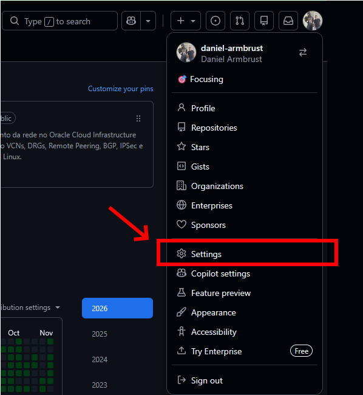
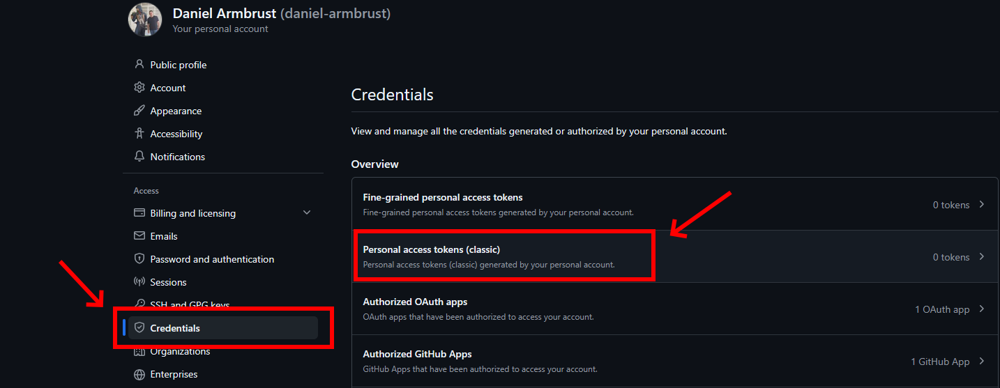
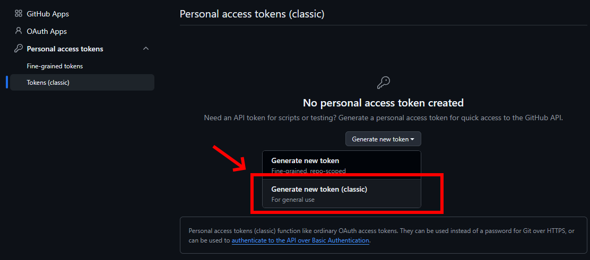
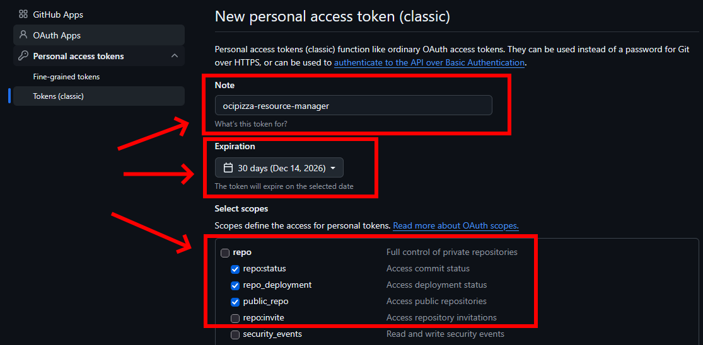
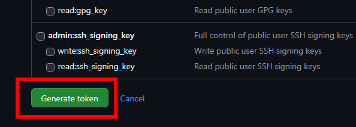
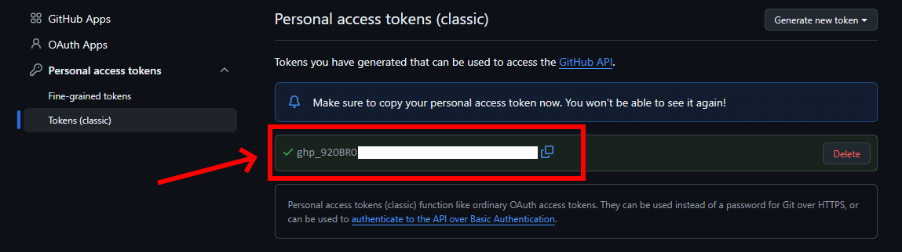

# OCI Pizza — Terraform

Este diretório reúne os dois ambientes Terraform responsáveis pela inicialização da automação e pelo provisionamento da infraestrutura da OCI Pizza.

## Diretórios

| Diretório | Responsabilidade |
| --- | --- |
| `bootstrap/` | Executado inicialmente no ambiente local para configurar a integração com o GitHub e criar ou atualizar o stack do OCI Resource Manager. Também concentra os arquivos destinados aos recursos de IAM e OCI DevOps. |
| `infrastructure/` | Executado pelo OCI Resource Manager para provisionar a infraestrutura multirregião da aplicação em São Paulo e Vinhedo. |

Os dois diretórios possuem configurações e estados Terraform independentes. O bootstrap prepara a automação; o Resource Manager utiliza infrastructure para criar os recursos da aplicação.

## Bootstrap

### Propósito

O diretório terraform/bootstrap inicializa a plataforma de automação da OCI Pizza. Atualmente, ele configura a conexão do OCI Resource Manager com o GitHub e o stack que utiliza o código de terraform/infrastructure para provisionar a infraestrutura multirregião.

O provider oficial oracle/oci não possui resources Terraform para administrar o Configuration Source Provider e o stack do Resource Manager. Por isso, recursos terraform_data executam scripts que utilizam a OCI CLI para:

- criar ou atualizar a conexão com o GitHub;
- localizar o stack pelo nome;
- criar o stack quando ele não existe;
- atualizar sua origem Git e suas variáveis quando ele já existe;
- associar o stack ao diretório terraform/infrastructure do repositório.

O bootstrap não executa jobs de plan ou apply no stack de infraestrutura.

### Estrutura

| Arquivo | Função |
| --- | --- |
| .terraform.lock.hcl | Registra a versão selecionada do provider OCI. |
| providers.tf | Declara a versão do Terraform e o provider OCI de GRU. |
| variables.tf | Declara as configurações recebidas pelo bootstrap. |
| locals.tf | Centraliza a identificação da região de GRU. |
| iam.tf | Cria as policies do grupo executor, o dynamic group das instâncias e as policies de acesso dos workloads aos serviços gerenciados. |
| devops.tf | Arquivo reservado para os recursos do OCI DevOps. |
| resource-manager.tf | Mapeia as variáveis Terraform para o ambiente do script e controla sua execução. |
| scripts/resource-manager-source-provider.sh | Cria ou atualiza a conexão do Resource Manager com o GitHub. |
| scripts/resource-manager-config.sh | Cria ou atualiza o stack por meio da OCI CLI. |
| outputs.tf | Publica os OCIDs do dynamic group e da policy criados pelo bootstrap. |
| terraform.tfvars.example | Apresenta exemplos das entradas aceitas pelo bootstrap. |

### Pré-requisitos

- Terraform 1.5 ou superior.
- OCI CLI instalada e autenticada.
- jq instalado.
- Personal Access Token do GitHub com permissão de leitura do repositório.
- Permissões para listar, criar e atualizar Configuration Source Providers e stacks no compartment escolhido.
- Permissões para criar dynamic groups na tenancy e policies no compartment da infraestrutura.

O bootstrap cria o Configuration Source Provider e utiliza seu OCID automaticamente na configuração do stack.
Durante o `terraform destroy`, o bootstrap remove primeiro a stack e depois o
Configuration Source Provider associado, ambos por meio da OCI CLI.
Como este bootstrap é específico da OCI Pizza no GitHub público, o endpoint do
Configuration Source Provider é fixado em `https://github.com` pelo script
`resource-manager-source-provider.sh` e seu nome é fixado em
`github-ocipizza`; esses valores não são configuráveis por variáveis.

### Geração do Personal Access Token do GitHub

O Configuration Source Provider utiliza um Personal Access Token (PAT) clássico
para acessar o repositório no GitHub. A documentação da OCI exige o escopo
`repo`, inclusive para o acesso realizado pelo Resource Manager. Gere o token
com uma conta que tenha acesso ao repositório configurado em
`resource_manager_repository_url`.

1. No GitHub, abra o menu do perfil no canto superior direito e selecione
   **Settings**.

   

2. Na página de configurações, abra **Credentials** e selecione
   **Personal access tokens (classic)**.

   

3. Em **Personal access tokens (classic)**, abra **Generate new token** e
   selecione **Generate new token (classic)**. O GitHub pode solicitar uma nova
   autenticação antes de exibir o formulário.

   

4. Informe um nome que identifique o uso do token, como
   `ocipizza-resource-manager`, escolha uma data de expiração compatível com a
   política da organização e selecione o escopo **repo** exigido pela OCI.

   

5. Revise os campos e selecione **Generate token** no final da página.

   

6. Copie o token assim que ele for exibido. O GitHub não permite consultar o
   valor novamente depois que a página é fechada.

   

Exporte o valor somente na sessão do terminal que executará o bootstrap:

~~~bash
export GITHUB_ACCESS_TOKEN="ghp_substitua_pelo_token_gerado"
~~~

Não grave o PAT em `terraform.tfvars`, arquivos `.env`, scripts, histórico do
Git ou qualquer outro arquivo do repositório. O bootstrap lê o token diretamente
do ambiente para evitar armazená-lo no state do Terraform. Se a organização
utilizar SAML SSO, autorize o token para a organização antes de executar o
bootstrap. Quando o token expirar ou for revogado, gere outro, exporte o novo
valor e siga o procedimento de rotação descrito em **Como utilizar**.

Consulte também a documentação oficial sobre a
[criação do Configuration Source Provider na OCI](https://docs.oracle.com/en-us/iaas/Content/ResourceManager/Tasks/create-csp-github.htm)
e o [gerenciamento de tokens pessoais no GitHub](https://docs.github.com/en/authentication/keeping-your-account-and-data-secure/managing-your-personal-access-tokens).

### Variáveis fornecidas ao Terraform

O Terraform lê variáveis de ambiente com o prefixo TF_VAR_. Por exemplo, a variável Terraform infrastructure_compartment_id é fornecida como TF_VAR_infrastructure_compartment_id.

| Variável de ambiente | Obrigatória | Padrão | Papel |
| --- | --- | --- | --- |
| TF_VAR_tenancy_id | Sim | — | OCID da tenancy onde o dynamic group será criado. |
| TF_VAR_resource_manager_compartment_id | Sim | — | OCID do compartment que armazenará o stack do Resource Manager. Pode ser diferente do compartment que receberá a infraestrutura. |
| TF_VAR_iam_dynamic_group_name | Não | ocipizza-instances | Nome do dynamic group que inclui as instâncias do compartment da infraestrutura. |
| TF_VAR_iam_policy_name | Não | ocipizza-instance-principals | Nome da policy concedida ao dynamic group. |
| TF_VAR_infrastructure_deployer_group_id | Sim | — | OCID do grupo IAM ao qual pertence o usuário que cria e executa os jobs do stack. |
| TF_VAR_infrastructure_deployer_policy_name | Não | ocipizza-infrastructure-deployer | Nome da policy que permite ao grupo executor gerenciar os recursos nos compartments do Resource Manager e da infraestrutura. |
| TF_VAR_service_principals_policy_name | Não | ocipizza-service-principals | Nome da policy concedida aos serviços gerenciados utilizados pelo OCI Pizza. |
| TF_VAR_resource_manager_stack_name | Não | ocipizza-infrastructure | Nome usado para localizar, criar ou atualizar o stack. |
| TF_VAR_resource_manager_repository_url | Não | https://github.com/daniel-armbrust/ocn-ocipizza.git | Repositório Git que contém o código da infraestrutura. |
| TF_VAR_resource_manager_repository_branch | Não | main | Branch obtida pelo Resource Manager em cada job. |
| TF_VAR_resource_manager_working_directory | Não | terraform/infrastructure | Diretório do repositório tratado como root module pelo stack. |
| TF_VAR_resource_manager_terraform_version | Não | 1.5.x | Versão do Terraform utilizada pelos jobs do Resource Manager. |
| TF_VAR_infrastructure_compartment_id | Sim | — | OCID enviado ao stack como compartment_id; define onde os recursos da infraestrutura serão provisionados. |
| TF_VAR_firewall_ssh_public_key | Sim | — | Chave pública enviada como firewall_ssh_public_key e instalada nas instâncias Compute Firewall. |
| TF_VAR_oke_worker_ssh_public_key | Sim | — | Chave pública enviada como oke_worker_ssh_public_key e instalada nos worker nodes do OKE. |

As chaves informadas devem ser públicas. Chaves privadas, tokens do GitHub e outros segredos não devem ser fornecidos como variáveis desse Terraform.

### IAM dos workloads

O bootstrap cria o dynamic group `ocipizza-instances` e todas as policies IAM
no root compartment da tenancy. A regra do dynamic group inclui as instâncias
Compute do compartment indicado por
`infrastructure_compartment_id`, o que abrange os worker nodes dos clusters OKE
criados nesse compartment.

A policy associada concede aos Instance Principals:

- leitura dos metadados das tabelas e gerenciamento das linhas no NoSQL;
- leitura dos buckets e gerenciamento dos objetos no Object Storage;
- leitura das filas, produção e consumo de mensagens no Queue;
- envio de mensagens pelo Email Delivery;
- leitura dos secret bundles no Secret Management;
- envio de conteúdo ao Logging.

Os nomes do dynamic group e da policy podem ser alterados por
`TF_VAR_iam_dynamic_group_name` e `TF_VAR_iam_policy_name`. As permissões ficam
restritas ao compartment informado por `TF_VAR_infrastructure_compartment_id`.
O stack do Resource Manager continua responsável pela criação e administração
das tabelas, buckets, filas e demais recursos da infraestrutura.

### IAM do provisionamento da infraestrutura

Os jobs do OCI Resource Manager são autorizados pelas policies do usuário que
inicia cada job. Por isso, o bootstrap também cria a policy
`ocipizza-infrastructure-deployer` para o grupo informado em
`TF_VAR_infrastructure_deployer_group_id`. O usuário responsável pelos jobs de
plan, apply e destroy deve pertencer a esse grupo.

A policy concede, no compartment de infraestrutura, as permissões exigidas
pelos recursos declarados em `terraform/infrastructure`:

- gerenciamento de VCNs, sub-redes, gateways, tabelas de rotas, security lists,
  DRGs, attachments e remote peering por meio de `virtual-network-family`;
- gerenciamento de instâncias Compute e volumes utilizados pelos firewalls e
  pelos worker nodes;
- gerenciamento dos clusters e node pools do OKE;
- gerenciamento dos Network Load Balancers;
- gerenciamento de DNS, Email Delivery, NoSQL, Object Storage, Queue, OCI Cache
  com engine Valkey e Logging;
- leitura dos Availability Domains, compartments e namespace do Object Storage;
- gerenciamento do Configuration Source Provider, do stack e dos jobs no
  compartment do Resource Manager.

Também são criadas as service policies necessárias para o OKE gerenciar IPs
privados, para o Email Delivery ler sua configuração e para o Object Storage
replicar objetos entre `sa-saopaulo-1` e `sa-vinhedo-1`. As permissões de
provisionamento são concedidas ao grupo por OCID, evitando dependência do nome
do Identity Domain.

### Variáveis recebidas pelos scripts

Os scripts do Resource Manager não precisam ser executados manualmente. No
fluxo suportado, o usuário executa `terraform apply` no Linux local e define as
entradas do bootstrap com o prefixo `TF_VAR_`. O `local-exec` converte essas
entradas para os nomes internos esperados pelos scripts. Por exemplo,
`TF_VAR_firewall_ssh_public_key` é repassada como
`FIREWALL_SSH_PUBLIC_KEY`.

`GITHUB_ACCESS_TOKEN` é uma exceção: ela sempre é lida diretamente do ambiente,
inclusive durante o `terraform apply`, para não ser armazenada no state.

| Variável interna | Origem | Papel no script |
| --- | --- | --- |
| RESOURCE_MANAGER_COMPARTMENT_ID | resource_manager_compartment_id | Define onde o script procura ou cria o stack. |
| GITHUB_ACCESS_TOKEN | Ambiente do processo | Fornece o PAT usado para criar ou atualizar a conexão; não é uma variável Terraform. |
| RESOURCE_MANAGER_STACK_NAME | resource_manager_stack_name | Identifica o stack durante a consulta, criação e atualização. |
| RESOURCE_MANAGER_REPOSITORY_URL | resource_manager_repository_url | Define a URL Git obtida pelo Resource Manager. |
| RESOURCE_MANAGER_REPOSITORY_BRANCH | resource_manager_repository_branch | Define a branch Git do stack. |
| RESOURCE_MANAGER_WORKING_DIRECTORY | resource_manager_working_directory | Define o diretório de execução do Terraform de infraestrutura. |
| RESOURCE_MANAGER_TERRAFORM_VERSION | resource_manager_terraform_version | Define a versão do Terraform do stack. |
| INFRASTRUCTURE_COMPARTMENT_ID | infrastructure_compartment_id | Alimenta a variável compartment_id do stack. |
| FIREWALL_SSH_PUBLIC_KEY | firewall_ssh_public_key | Alimenta a variável firewall_ssh_public_key do stack. |
| OKE_WORKER_SSH_PUBLIC_KEY | oke_worker_ssh_public_key | Alimenta a variável oke_worker_ssh_public_key do stack. |

### Autenticação da OCI CLI

O script utiliza a autenticação já configurada para a OCI CLI. No uso local, ela normalmente é definida em ~/.oci/config. Quando houver mais de um profile, selecione-o antes da execução:

~~~bash
export OCI_CLI_PROFILE="DEFAULT"
~~~

As configurações de autenticação da OCI CLI são herdadas pelo script e não são armazenadas em resource-manager.tf.

### Como utilizar

A partir da raiz do repositório, entre no diretório do bootstrap:

~~~bash
cd terraform/bootstrap
~~~

Crie um par de chaves SSH para o firewall e outro para os worker nodes do OKE.
As chaves públicas e privadas são armazenadas em `terraform/bootstrap/keys`.
Esse diretório está protegido pelo `.gitignore`, mas as chaves privadas ainda
devem permanecer protegidas e nunca devem ser compartilhadas:

~~~bash
mkdir -p keys
chmod 700 keys

ssh-keygen -t rsa -b 4096 -f keys/firewall -C "ocipizza-firewall"
ssh-keygen -t rsa -b 4096 -f keys/worker-nodes -C "ocipizza-worker-nodes"

chmod 400 keys/firewall keys/worker-nodes
~~~

Durante a criação, o `ssh-keygen` solicitará uma passphrase para proteger cada
chave privada. Os arquivos terminados em `.pub` são as chaves públicas que
serão enviadas ao OCI.

Exporte as entradas obrigatórias. O exemplo utiliza o mesmo compartment para a
stack do Resource Manager e para a infraestrutura do OCI Pizza:

~~~bash
export COMPARTMENT_ID="ocid1.compartment.oc1..substitua"

export TF_VAR_resource_manager_compartment_id="$COMPARTMENT_ID"
export TF_VAR_infrastructure_compartment_id="$COMPARTMENT_ID"
export TF_VAR_tenancy_id="ocid1.tenancy.oc1..substitua"
export TF_VAR_infrastructure_deployer_group_id="ocid1.group.oc1..substitua"
export TF_VAR_firewall_ssh_public_key="$(cat $HOME/ocn-ocipizza/terraform/bootstrap/keys/firewall.pub)"
export TF_VAR_oke_worker_ssh_public_key="$(cat $HOME/ocn-ocipizza/terraform/bootstrap/keys/worker-nodes.pub)"
export GITHUB_ACCESS_TOKEN="github_pat_substitua"
~~~

GITHUB_ACCESS_TOKEN é lida diretamente pelo script e não deve utilizar o prefixo TF_VAR_. Dessa forma, o PAT não é incluído no estado Terraform. Segundo a OCI, o token deve permitir o acesso ao repositório; para tokens clássicos, o escopo exigido pelo Resource Manager é repo. O token não deve ser salvo em terraform.tfvars nem adicionado ao repositório.

As duas variáveis de chave SSH são obrigatórias e devem receber o conteúdo das
chaves públicas, não o caminho dos arquivos. O bootstrap não lê chaves
automaticamente do diretório `terraform/bootstrap/keys`.

Para alterar os valores padrão, exporte também as entradas opcionais:

~~~bash
export TF_VAR_resource_manager_stack_name="ocipizza-infrastructure"
export TF_VAR_resource_manager_repository_url="https://github.com/daniel-armbrust/ocn-ocipizza.git"
export TF_VAR_resource_manager_repository_branch="main"
export TF_VAR_resource_manager_working_directory="terraform/infrastructure"
export TF_VAR_resource_manager_terraform_version="1.5.x"
export TF_VAR_iam_dynamic_group_name="ocipizza-instances"
export TF_VAR_iam_policy_name="ocipizza-instance-principals"
export TF_VAR_infrastructure_deployer_policy_name="ocipizza-infrastructure-deployer"
export TF_VAR_service_principals_policy_name="ocipizza-service-principals"
~~~

Inicialize e valide o bootstrap:

~~~bash
terraform init
terraform fmt -check
terraform validate
terraform plan
~~~

Crie ou atualize o stack:

~~~bash
terraform apply
~~~

Na primeira execução, o bootstrap cria a conexão GitHub e depois cria o stack. A dependência declarada em resource-manager.tf garante essa ordem. Quando as configurações mudam, os recursos terraform_data correspondentes são substituídos e os scripts atualizam os recursos existentes.

Como o PAT não é armazenado no state, sua alteração isolada não é detectada pelo Terraform. Para rotacionar o token, exporte o novo valor e force a execução do script:

~~~bash
terraform apply -replace=terraform_data.configuration_source_provider
~~~

Como alternativa às variáveis de ambiente, terraform.tfvars.example pode ser copiado para um arquivo local terraform.tfvars e preenchido. Valores reais de OCIDs e chaves não devem ser versionados.

### Limites do ciclo de vida

O stack é criado pela OCI CLI e não é um resource administrado diretamente pelo provider Terraform. Consequentemente:

- remover terraform_data.resource_manager_stack não exclui o stack da OCI;
- terraform destroy não exclui o stack;
- alterações manuais no stack não são detectadas como drift pelo estado do bootstrap;
- uma execução sem mudanças nas entradas não chama o script novamente;
- os jobs de plan e apply de terraform/infrastructure são responsabilidades das pipelines do OCI DevOps ou de uma execução explícita no Resource Manager.

### Estado Terraform

O bootstrap possui um estado independente do estado mantido pelo Resource Manager para terraform/infrastructure.

O estado do bootstrap deve permanecer protegido e não deve ser versionado. Embora as chaves SSH utilizadas sejam públicas, seus valores fazem parte das entradas registradas no estado do bootstrap.

## Infrastructure

O diretório `terraform/infrastructure` contém o root module e os módulos locais que declaram a infraestrutura completa da OCI Pizza na OCI.

Essa configuração provisiona recursos nas regiões `sa-saopaulo-1` (GRU) e `sa-vinhedo-1` (VCP), incluindo:

- VCNs, sub-redes, gateways e regras de segurança;
- DRGs e conectividade entre regiões;
- instâncias de firewall e Network Load Balancers privados;
- clusters OKE e seus worker nodes;
- DNS, IPs públicos e serviços de e-mail;
- NoSQL, Object Storage, Queue e Valkey;
- recursos de logging e observabilidade.

O estado desse ambiente é mantido pelo OCI Resource Manager. Os valores necessários às pipelines posteriores são publicados pelos outputs do root module.

A descrição detalhada dos arquivos e módulos está disponível em [infrastructure/README.md](infrastructure/README.md).
